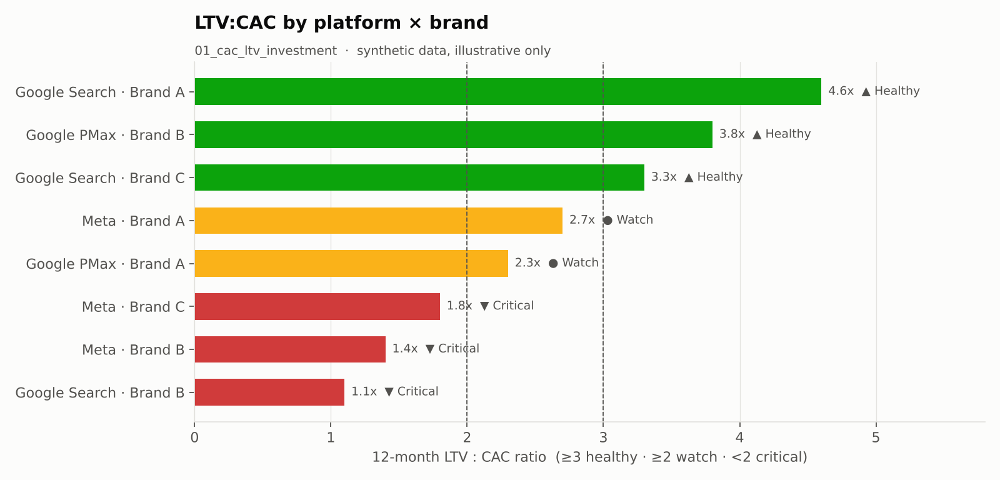
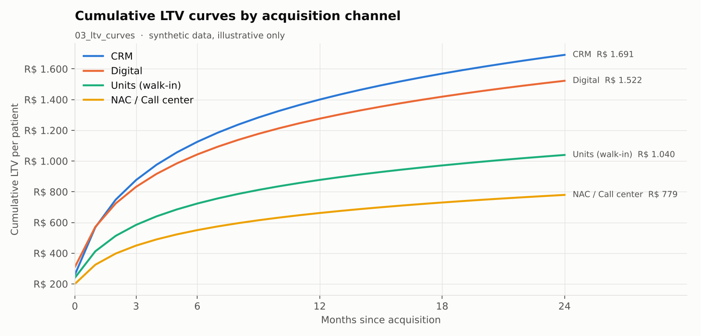
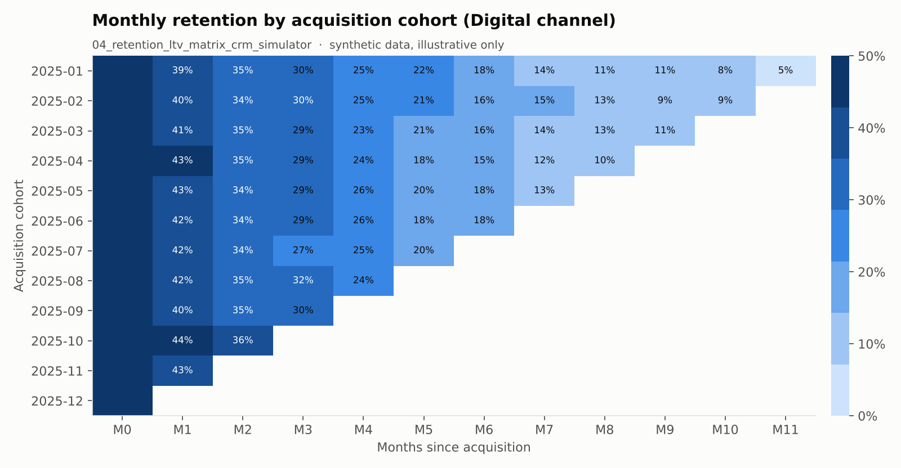
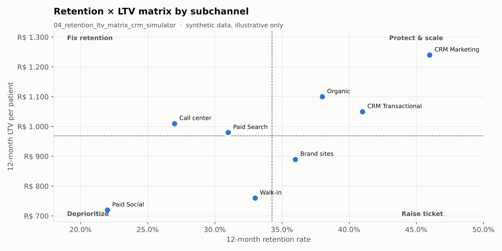
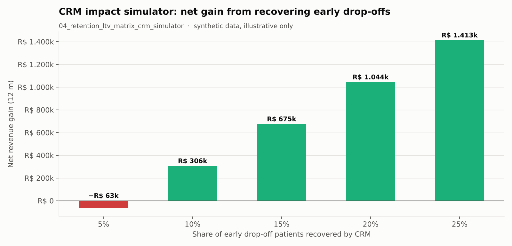

# 💉 LTV Patient — Lifetime Value, Retention & CAC Analytics

> **End-to-end analytics project (BigQuery + Python) to measure and optimize patient lifetime value across acquisition channels: CAC × LTV, profitable acquisition paths, LTV curves, Retention × LTV matrix and a CRM impact simulator.**

🇺🇸 English | [🇧🇷 Português](README.pt-br.md)

---

## Overview

Built for a large multi-brand healthcare diagnostics company (Brazil), this project turns patient-level appointment data into investment decisions:

- **Where should media budget increase or decrease?** (CAC × LTV by platform and brand)
- **Which acquisition path brings the most profitable new patient?**
- **How does patient value evolve over time, by channel and payer type?**
- **Is it worth more to retain (CRM) or to acquire (paid media)?**

> 🔒 Project, dataset and brand names were anonymized (`analytics-project`, `MARCA_01`…) and **all notebook outputs were cleared**. The repository contains only the analysis logic — no real data or results.

---

## Business Problem

Media teams usually optimize for CPC/CPL and channel-level ROAS. That hides two things:

1. A cheap channel can bring **low-value patients**, while an "expensive" one can pay back several times over 12 months.
2. Most value is lost **early in the lifecycle** — patients who don't return in the first months rarely come back, and that is a CRM problem, not a media problem.

This project connects acquisition cost with long-term patient value to make both visible.

---

## Notebooks

| # | Notebook | Business question | Methodology highlights |
|---|---|---|---|
| 01 | `01_cac_ltv_investment.ipynb` | Where to increase or cut investment by platform × brand? | 5 chained CTEs: media cost → acquisition cohort (`QUALIFY ROW_NUMBER()`) → CAC → cumulative LTV at 3/6/12/24 m → LTV:CAC and payback. Health semaphore: ≥ 3 healthy, ≥ 2 watch, < 2 critical |
| 02 | `02_profitable_acquisition_paths.ipynb` | Which full path (subchannel × campaign × payer × product × brand × age × sex) brings the most profitable new patient? | Path ranking by 12-month profitability score; all-channels view + Paid Search variant |
| 03 | `03_ltv_curves.ipynb` | How does value accumulate per patient by channel, subchannel and payer type? | Cumulative revenue via window function ÷ cohort size; payer type fixed at acquisition |
| 04 | `04_retention_ltv_matrix_crm_simulator.ipynb` | Retain or acquire? When does CRM have the most impact? | Retention × LTV matrix (channel, subchannel, brand, product group), LTV = ticket × frequency × retention, early drop-off, CRM simulator, optimal reactivation window, survival/hazard, Gini/Lorenz, slope analysis |

---

## Architecture

```
 martech-analysis / 01_patient_temporal_classification  ──►  tb_temporal_class_pac_atd2
                                                                     │
          Media cost (Google / Meta Ads)  ──────────────┐            │
                                                        ▼            ▼
                                             ┌───────────────────────────────┐
                                             │ BigQuery queries (inside each  │
                                             │ notebook) → pandas DataFrame   │
                                             └───────────────┬───────────────┘
                                                             ▼
                          Aggregation & plotting functions (pandas / matplotlib / seaborn)
                                                             ▼
                          Charts + tables + executive summary (CSV / XLSX / PNG in outputs/)
```

The patient classification table comes from the companion project [**martech-analysis**](https://github.com/pedrougusto/martech-analysis).

---

## Dashboard Preview

> Charts generated with **synthetic data** to illustrate the notebook outputs — they do not represent real company figures.

| LTV:CAC by platform × brand (`01`) | Cumulative LTV curves (`03`) |
|---|---|
|  |  |
| **Cohort retention heatmap (`04`)** | **Retention × LTV matrix (`04`)** |
|  |  |



---

## Key Technical Highlights

- **No double counting:** cohort size is computed before joining dimensions, and cohorts are deduplicated with `QUALIFY ROW_NUMBER()`.
- **Correct cumulative LTV:** `SUM() OVER (... ROWS BETWEEN UNBOUNDED PRECEDING AND CURRENT ROW)` partitioned by cohort, avoiding numerator/denominator inflation.
- **Single load, many cuts:** one query per notebook; every downstream view is built in pandas from the same DataFrame.
- **Decision layer, not just KPIs:** the CRM simulator converts early drop-off into expected revenue, comparable with media cost.

---

## How to Run

```bash
pip install -r requirements.txt
gcloud auth application-default login   # BigQuery credentials
jupyter lab notebooks/
```

Update the project/dataset names in the configuration cell of each notebook to point to your own tables.

---

## Stack

| Layer | Technology |
|---|---|
| Data Warehouse | Google BigQuery |
| Query layer | SQL (CTEs, window functions, `QUALIFY`) |
| Analysis | Python — pandas, numpy |
| Visualization | matplotlib, seaborn |
| Environment | Jupyter Notebooks |

---

## Repository Structure

```
ltv-patient/
├── notebooks/
│   ├── 01_cac_ltv_investment.ipynb
│   ├── 02_profitable_acquisition_paths.ipynb
│   ├── 03_ltv_curves.ipynb
│   └── 04_retention_ltv_matrix_crm_simulator.ipynb
├── docs/
│   └── images/            # dashboard previews (synthetic data)
├── requirements.txt
├── LICENSE
├── README.md
└── README.pt-br.md
```

---

## So What?

- **Business impact:** budget moves to (platform × brand) combinations with proven long-term return instead of the cheapest acquisition, and retention gets a revenue number that can compete with media for investment.
- **Recommended action:** reallocate spend away from combinations below 2× LTV:CAC, and launch CRM reactivation in the window where patients naturally return (notebook 04) before buying them back through paid media.

---

## About

Built by **Pedro Augusto** — Analytics Engineer focused on Marketing Analytics, MarTech and Growth.
Notebook comments are in Portuguese (original working language); documentation is bilingual.
