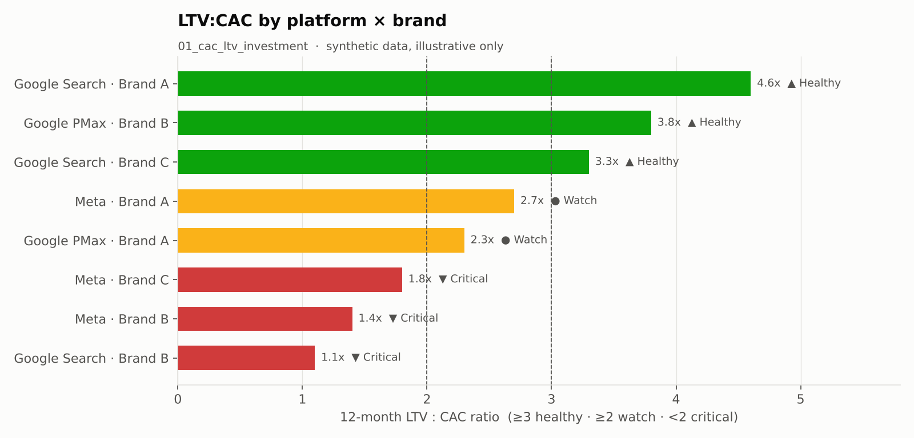
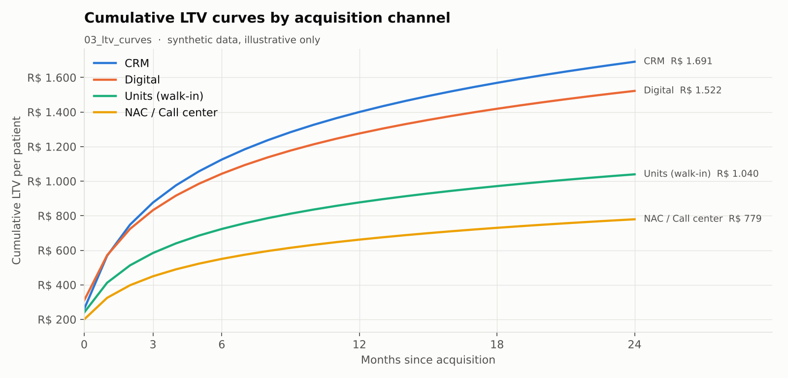
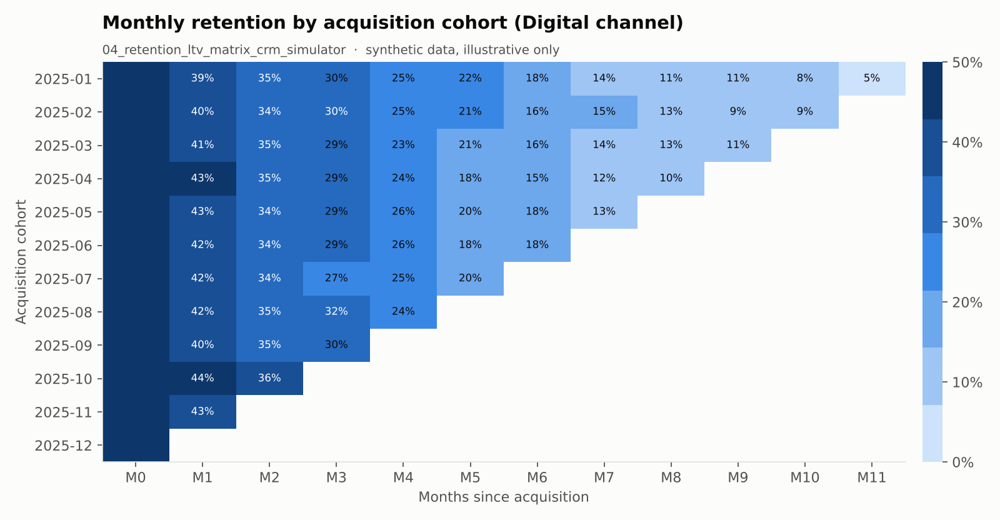
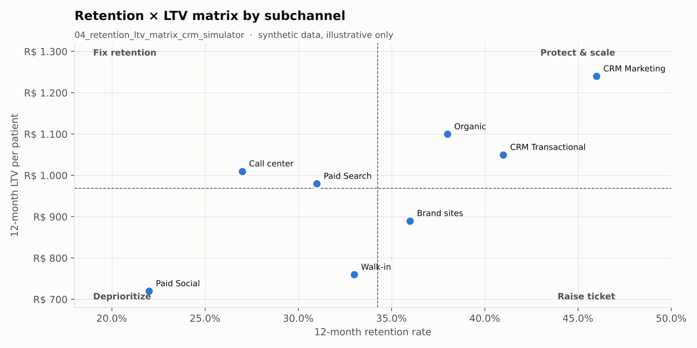
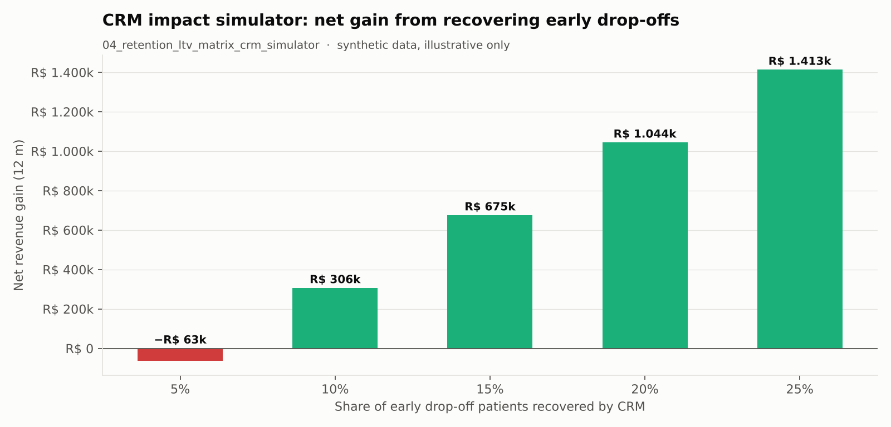

# 💉 LTV Patient — Lifetime Value, Retenção e CAC

> **Projeto de analytics end-to-end (BigQuery + Python) para medir e otimizar o lifetime value do paciente por canal de aquisição: CAC × LTV, caminhos de aquisição mais rentáveis, curvas de LTV, matriz Retenção × LTV e simulador de impacto de CRM.**

[🇺🇸 English](README.md) | 🇧🇷 Português

---

## Visão Geral

Desenvolvido para uma grande empresa de diagnósticos de saúde multimarcas (Brasil), este projeto transforma dados de atendimento por paciente em decisões de investimento:

- **Onde aumentar ou reduzir o budget de mídia?** (CAC × LTV por plataforma e marca)
- **Qual caminho de aquisição traz o paciente novo mais rentável?**
- **Como o valor do paciente evolui no tempo, por canal e tipo de convênio?**
- **Vale mais reter (CRM) ou adquirir (mídia paga)?**

> 🔒 Nomes de projeto, dataset e marca foram anonimizados (`analytics-project`, `MARCA_01`…) e **todos os outputs dos notebooks foram limpos**. O repositório contém apenas a lógica das análises — nenhum dado ou resultado real.

---

## Problema de Negócio

Times de mídia costumam otimizar por CPC/CPL e ROAS por canal. Isso esconde duas coisas:

1. Um canal barato pode trazer **pacientes de baixo valor**, enquanto um canal "caro" pode se pagar várias vezes em 12 meses.
2. A maior parte do valor se perde **no início do ciclo de vida** — quem não volta nos primeiros meses raramente retorna, e isso é um problema de CRM, não de mídia.

Este projeto conecta custo de aquisição com valor do paciente no longo prazo para tornar as duas coisas visíveis.

---

## Notebooks

| # | Notebook | Pergunta de negócio | Destaques de metodologia |
|---|---|---|---|
| 01 | `01_cac_ltv_investment.ipynb` | Onde aumentar ou cortar investimento por plataforma × marca? | 5 CTEs encadeadas: custo de mídia → coorte de aquisição (`QUALIFY ROW_NUMBER()`) → CAC → LTV acumulado em 3/6/12/24 m → LTV:CAC e payback. Semáforo: ≥ 3 saudável, ≥ 2 atenção, < 2 crítico |
| 02 | `02_profitable_acquisition_paths.ipynb` | Qual caminho completo (subcanal × campanha × convênio × produto × marca × faixa etária × sexo) traz o paciente novo mais rentável? | Ranking de caminhos por score de rentabilidade em 12 meses; visão de todos os canais + variante Paid Search |
| 03 | `03_ltv_curves.ipynb` | Como o valor se acumula por paciente por canal, subcanal e tipo de convênio? | Receita acumulada via window function ÷ tamanho da coorte; convênio fixado no momento da aquisição |
| 04 | `04_retention_ltv_matrix_crm_simulator.ipynb` | Reter ou adquirir? Quando o CRM tem mais impacto? | Matriz Retenção × LTV (canal, subcanal, marca, grupo de exames), LTV = ticket × frequência × retenção, early drop-off, simulador de CRM, janela ótima de reativação, sobrevivência/hazard, Gini/Lorenz, slope analysis |

---

## Arquitetura

```
 martech-analysis / 01_patient_temporal_classification  ──►  tb_temporal_class_pac_atd2
                                                                     │
          Custo de mídia (Google / Meta Ads)  ──────────┐            │
                                                        ▼            ▼
                                             ┌───────────────────────────────┐
                                             │ Queries BigQuery (dentro de    │
                                             │ cada notebook) → DataFrame     │
                                             └───────────────┬───────────────┘
                                                             ▼
                          Funções de agregação e gráfico (pandas / matplotlib / seaborn)
                                                             ▼
                          Gráficos + tabelas + resumo executivo (CSV / XLSX / PNG em outputs/)
```

A tabela de classificação de pacientes vem do projeto complementar [**martech-analysis**](https://github.com/pedrougusto/martech-analysis).

---

## Prévia dos Dashboards

> Gráficos gerados com **dados sintéticos** para ilustrar as saídas dos notebooks — não representam números reais da empresa.

| LTV:CAC por plataforma × marca (`01`) | Curvas de LTV acumulado (`03`) |
|---|---|
|  |  |
| **Heatmap de retenção por coorte (`04`)** | **Matriz Retenção × LTV (`04`)** |
|  |  |



---

## Destaques Técnicos

- **Sem contagem dupla:** o tamanho da coorte é calculado antes do join com as dimensões, e as coortes são deduplicadas com `QUALIFY ROW_NUMBER()`.
- **LTV acumulado correto:** `SUM() OVER (... ROWS BETWEEN UNBOUNDED PRECEDING AND CURRENT ROW)` particionado por coorte, evitando inflação de numerador/denominador.
- **Uma carga, vários cortes:** uma query por notebook; todas as visões seguintes saem do mesmo DataFrame em pandas.
- **Camada de decisão, não só KPI:** o simulador de CRM converte early drop-off em receita esperada, comparável ao custo de mídia.

---

## Como Executar

```bash
pip install -r requirements.txt
gcloud auth application-default login   # credenciais do BigQuery
jupyter lab notebooks/
```

Atualize os nomes de projeto/dataset na célula de configuração de cada notebook para apontar para as suas tabelas.

---

## Stack

| Camada | Tecnologia |
|---|---|
| Data Warehouse | Google BigQuery |
| Camada de query | SQL (CTEs, window functions, `QUALIFY`) |
| Análise | Python — pandas, numpy |
| Visualização | matplotlib, seaborn |
| Ambiente | Jupyter Notebooks |

---

## Estrutura do Repositório

```
ltv-patient/
├── notebooks/
│   ├── 01_cac_ltv_investment.ipynb
│   ├── 02_profitable_acquisition_paths.ipynb
│   ├── 03_ltv_curves.ipynb
│   └── 04_retention_ltv_matrix_crm_simulator.ipynb
├── docs/
│   └── images/            # prévias dos dashboards (dados sintéticos)
├── requirements.txt
├── LICENSE
├── README.md
└── README.pt-br.md
```

---

## So What?

- **Impacto no negócio:** o budget vai para combinações (plataforma × marca) com retorno comprovado no longo prazo, e não para a aquisição mais barata; a retenção ganha um número em receita que pode competir com mídia por investimento.
- **Ação recomendada:** realocar verba das combinações abaixo de 2× LTV:CAC e ativar reativação via CRM na janela em que o paciente naturalmente retorna (notebook 04), antes de recomprá-lo via mídia paga.

---

## Sobre

Desenvolvido por **Pedro Augusto** — Analytics Engineer com foco em Marketing Analytics, MarTech e Growth.
Os comentários dos notebooks estão em português (idioma original de trabalho); a documentação é bilíngue.
